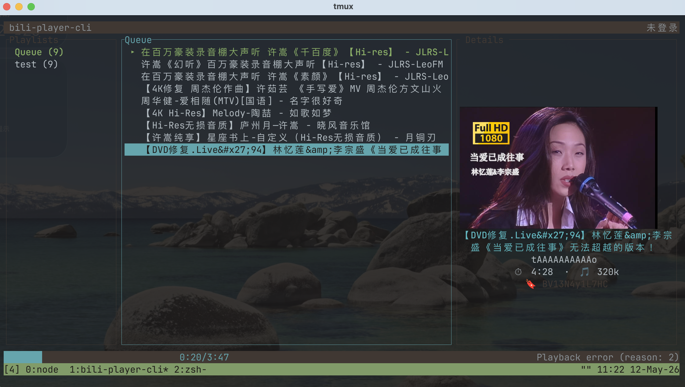

# bili-player-cli

一个在终端里听 B 站的音频播放器。  
A terminal-based Bilibili audio player — search, browse, and play, all from your shell.

---



---

## 灵感来源

- **[Azusa](https://github.com/kenmingwang/azusa-player)** — 浏览器扩展，将 B 站视频转换为纯音频播放，支持歌单管理和歌词搜索。
- **[NoxPlayer](https://github.com/lovegaoshi/NoxPlayer)** — 同样是面向 B 站的浏览器扩展播放器，支持 YouTube，有歌单云备份、音量归一化等功能，并有配套移动端。

---

## 功能

- **搜索 B 站**关键词；或在搜索框粘贴 BV 号 / 完整 URL 获取视频后选择播放
- **完整播放控制**：播放/暂停、上/下一曲、快进快退、音量调节、静音
- **Shuffle & Repeat**：顺序 / 列表循环 / 单曲循环 / 随机四种模式
- **歌单管理**：创建、删除歌单，添加/移除曲目，导入 B 站收藏夹，重启后持久保留
- **多 P 视频（分P）**：选择任意分P 播放，并将后续分P 顺序入队
- **封面图显示**：支持 Kitty / Sixel / iTerm2 / Halfblocks 协议

---

## 构建与安装

### 前置依赖

- **Rust (stable, edition 2024)** — 推荐通过 [rustup](https://rustup.rs) 安装
- **libmpv** — 音频后端
  - macOS: `brew install mpv`
  - Linux (Debian/Ubuntu): `apt install libmpv-dev`
  - Linux (Arch): `pacman -S mpv`

### 构建

```bash
git clone https://github.com/TalpsG/bili-player-tui
cd bili-player-tui
cargo build --release
# 产物位于: target/release/bili-player-cli
```

### 运行

```bash
# 启动 TUI
./target/release/bili-player-cli

# 直接播放指定视频
./target/release/bili-player-cli play BV1xx411c7mD
```

---

## 快捷键

操作遵循 Vim 风格：列表中用 `j` / `k` 上下移动，主界面用 `h` / `l` 切换焦点；`Enter` 选择、播放或展开分P，`Esc` 退出当前模式或返回上一层。主界面按 `q` 退出。

搜索中按 `i` 进入输入模式，`Esc` 返回普通模式；输入模式中的 `q` 等字符用于输入。

常用特殊按键：

- `/` 搜索关键词、BV 号或视频链接。
- `Space` 播放 / 暂停，`n` / `p` 下一首 / 上一首，`r` 切换播放模式。
- `v` 在主界面切换详情。
- `I`（大写 i）在歌单栏导入收藏夹 URL / ID；`A` 将选中曲目或搜索结果加入歌单。

按 `?` 查看帮助，完整按键与适用场景见 [KEYBINDINGS.md](./KEYBINDINGS.md)。

---

## 架构简介

Rust 编写，tokio 异步运行时，ratatui + crossterm 驱动 TUI，libmpv2 作为音频后端，reqwest (rustls) 负责 Bilibili API 请求。`App` 是唯一的状态所有者，主循环通过 `tokio::select!` 串行处理终端输入、mpv 事件和定时 tick。

---

## License

MIT License. Contributions welcome — open an issue or PR.
